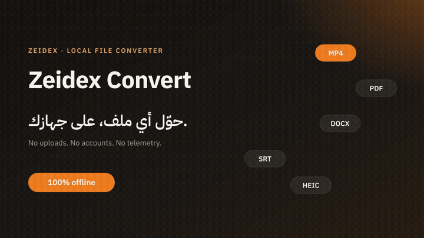

<p align="center">
  
</p>

<p align="center">
  <a href="https://github.com/zeiad6/zeidexfileconventer/releases/latest"></a>
  <a href="LICENSE"></a>
  
  <a href="https://github.com/zeiad6/zeidexfileconventer/actions/workflows/build.yml"></a>
</p>

<p align="center">
  <b>حوّل أي ملف، على جهازك، دون رفع.</b><br>
  اسحب ملفاً، اضغط <kbd>Shift</kbd>، وأفلته على الصيغة التي تريدها.
</p>

---

## ما هو؟

**Zeidex Convert** محوّل ملفات ومعالج وسائط يعمل **بالكامل دون إنترنت**. لا حساب، ولا سحابة، ولا طابور انتظار: الملف يُقرأ من قرصك ويُكتب على قرصك، والبرنامج يعمل حتى لو فصلت الشبكة.

النسخة المكتبية مكتوبة بـ **Rust + Tauri 2** وواجهتها **React 19 + TypeScript + Tailwind v4**، والنسخة الجوالة بـ **Kotlin + Jetpack Compose**. المحرّكات الثقيلة (FFmpeg، libvips، qpdf، Pandoc، 7-Zip، Tesseract) تعمل محلياً.

<p align="center">
  
  <br>
  <a href="docs/assets/demo.mp4">▶ تشغيل الفيديو بجودة كاملة (MP4)</a>
</p>

## العجلة

<p align="center">
  
</p>

ملف واحد، عشرات الصيغ. عند سحب ملف مع إبقاء <kbd>Shift</kbd> مضغوطاً تدور حوله حلقة من الأهداف؛ أفلته على الهدف ليبدأ التحويل فوراً، مع معاينة مباشرة للنتيجة. العجلة نافذة شفافة دائماً في الأعلى، فلا تحتاج إلى فتح التطبيق لكل ملف.

## المزايا

| | الميزة |
|---|---|
| 🎯 | **العجلة**: تحويل بالسحب والإفلات إلى 40+ صيغة بضغطة واحدة |
| 🖼️ | **الصور**: JPEG، PNG، WebP، AVIF، HEIC، TIFF، GIF، BMP، SVG، ICO، PDF، مع قصّ بنِسب جاهزة وإزالة EXIF |
| 🎬 | **الفيديو**: MP4، MKV، WebM، MOV، AVI، GIF، MP3، M4A، WAV؛ ضغط، قصّ، تسريع، تدوير، دمج |
| 📄 | **المستندات**: PDF ↔ DOCX، PDF → صور، دمج وتقسيم وترتيب صفحات PDF، Markdown/HTML/EPUB/DOCX عبر Pandoc |
| ✍️ | **الترجمة النصية**: SRT ↔ VTT ↔ ASS، تفريغ صوتي محلي عبر whisper.cpp |
| 🔐 | **الخصوصية**: لا رفع، لا تتبّع، إزالة بيانات GPS والبيانات الوصفية اختيارياً |
| 🧹 | **الحذف الآمن**: Shredder بمرور واحد أو عدة مرورات للملفات الحساسة |
| 📡 | **LocalDrop**: إرسال الملفات من الحاسوب إلى الهاتف على نفس شبكة Wi-Fi عبر QR، دون سحابة |
| 👀 | **مجلدات المراقبة**: حوّل كل ما يصل إلى مجلد تختاره تلقائياً |
| 🪟 | **نافذة كاملة**: شريط عنوان بأزرار الإغلاق والتصغير والتكبير، وشريط جانبي ثابت لا ينزل مع التمرير، وتخطيط يتكيّف مع كل حجم نافذة |
| 🎛️ | **عجلة أصغر** (380px) تختفي تلقائياً بعد 4 ثوانٍ من عدم التحرك، مع انتقالات سلسة |
| 🌍 | **عربي وإنجليزي** بواجهة RTL كاملة، ووضع فاتح وداكن، وإظهار/إخفاء أيقونة الدرج من الإعدادات |

## التثبيت

### أسرع طريقة على لينكس

```bash
curl -fsSL https://raw.githubusercontent.com/zeiad6/zeidexfileconventer/main/packaging/linux/install.sh | sh
```

ينزّل سكربت التثبيت حزمة AppImage الواحدة إلى `~/.local`، ويتحقّق من SHA-256، ويضيف أيقونة ومدخلاً في قائمة التطبيقات — **دون `sudo` ودون أي طلب صلاحيات إدارية**. للإزالة: `sh install.sh --uninstall`.

### الملفات لكل نظام

| النظام | الملف | ملاحظات |
|---|---|---|
| **لينكس (x64 وarm64)** | `*.AppImage` | حزمة واحدة لكل التوزيعات، وواحدة لكل معمارية لأن المحرّكات المضمّنة معمارية. التثبيت بسطر واحد دون صلاحيات إدارية. مبنية على Ubuntu 22.04 (glibc 2.35): Debian 12+، Ubuntu 22.04+، Fedora 36+، Mint 21+، openSUSE 15.5+ |
| **Windows 10/11** | `*-setup.exe` | مثبّت واحد للمستخدم الحالي (بلا UAC)، عربي/إنجليزي. يستخدم WebView2 الموجود في Windows 11 وWindows 10 المحدّث، وينزّل مثبّت Microsoft الرسمي تلقائياً إن كان غائباً |
| **macOS 11+** | `*.dmg` | ملف واحد لكل معمارية (Apple Silicon أو Intel) لأن المحرّكات المضمّنة معمارية. غير موقّع: نقر يمين ← Open |
| **Android 8+** | `*.apk` | من [إصدارات مستودع أندرويد](https://github.com/zeiad6/zeidex-convert-android/releases) |

كل حزمة مكتفية: FFmpeg وFFprobe و7-Zip وPandoc وrhwp وqpdf وGhostscript مضمّنة داخلها، ويستخدم تحويل الصور FFmpeg المضمّن تلقائياً عند غياب libvips. توزيعات musl مثل Alpine تبني من المصدر.

للتحقّق من أي تنزيل: ضع `SHA256SUMS-<النظام>.txt` بجانب الحزمة ثم `sha256sum -c` (وعلى macOS: `shasum -a 256 -c`). الأسطر تحمل اسم الملف نفسه الذي يخدمه GitHub، فتظهر `OK` عند سلامة التنزيل.

> AppImage يحتاج `libfuse2` على بعض التوزيعات، أو شغّله بـ `--appimage-extract-and-run`.

## البناء من المصدر

```bash
# المتطلّبات: Rust 1.80+، Node 22+، واعتماديات Tauri (webkit2gtk-4.1 على لينكس)
git clone https://github.com/zeiad6/zeidexfileconventer.git
cd zeidexfileconventer

bash packaging/fetch-engines.sh      # لينكس وماك
./packaging/fetch-engines.ps1        # ويندوز

cd app && npm ci && npm run build && cd ..
cargo build --release -p zeidex-cli  # سطر الأوامر
cd app && npx tauri build            # الحزم المكتبية
```

الاختبارات: `cargo test --workspace`، `npm test` في `app/`، و`gradle :app:testDebugUnitTest` في `android/`.

## المعمار

```
crates/core      النواة: التخطيط والتنفيذ والتحقق، بلا أي تبعية خارجية
crates/cli       سطر الأوامر zeidex-convert (doctor، convert، watch، update)
crates/localdrop نقل الملفات على الشبكة المحلية
app/src-tauri    تطبيق Tauri: الأوامر، النوافذ، عجلة السحب
app/src          واجهة React 19 + TypeScript + Tailwind v4
android/         تطبيق أندرويد Kotlin + Compose (مستودع فرعي)
packaging/       المحرّكات، حزم لينكس، Flatpak، سجل التحديثات
```

## الخصوصية

- لا يفتح التطبيق أي اتصال شبكي إلا عند فحص التحديثات أو استخدام LocalDrop على شبكتك المحلية.
- لا تحليلات ولا تتبّع ولا معرّفات.
- إزالة EXIF/GPS خيار صريح في كل تحويل صور.
- التحديثات تُقبل فقط إذا طابقت SHA-256 **وشهادة التوقيع** المثبّتة في التطبيق.

## المطوّر

<table>
  <tr>
    <td width="96" align="center">
      
    </td>
    <td>
      <b>Zeidexsoft</b> — تطوير تطبيقات محلية سريعة تحترم الخصوصية.<br>
      المطوّر: <a href="https://github.com/zeiad6">@zeiad6</a> · الموقع: <a href="https://zeidexsoft.com">zeidexsoft.com</a> · بطاقة المطوّر: <a href="https://zeidexlink.zeidexsoft.com/zeidex">zeidexlink.zeidexsoft.com/zeidex</a>
    </td>
  </tr>
</table>

للدعم أو الاقتراحات: افتح [issue](https://github.com/zeiad6/zeidexfileconventer/issues) أو راسل المطوّر عبر [بطاقة المطوّر](https://zeidexlink.zeidexsoft.com/zeidex).

## الرخصة

[MIT](LICENSE) © 2026 Zeidexsoft. الكود مفتوح المصدر ومتاح للاستخدام التجاري والبيع داخل منتجك، مع الإبقاء على نص الترخيص. لا تُقدَّم أي ضمانات.

---

# English

<p align="center">
  <b>Convert anything, on your own machine.</b><br>
  Drag a file, hold <kbd>Shift</kbd>, drop it on the format you want.
</p>

**Zeidex Convert** is a fully offline file converter and media processor for **Windows, macOS, Linux and Android**. Files are read from your disk and written to your disk — no uploads, no accounts, no queue. The desktop app is **Rust + Tauri 2** with a **React 19 / TypeScript / Tailwind v4** interface; the Android app is **Kotlin + Jetpack Compose**. FFmpeg, libvips, qpdf, Pandoc, 7-Zip, Ghostscript and Tesseract do the work locally.

## Install

```bash
# Linux: one AppImage for every distribution, installed per-user with no sudo
curl -fsSL https://raw.githubusercontent.com/zeiad6/zeidexfileconventer/main/packaging/linux/install.sh | sh
```

One package per platform: **Linux** (`.AppImage` for x64 or arm64, matching the machine, installed into `~/.local` — no administrator prompt), **Windows** (`*-setup.exe`, per-user, no UAC), **macOS** (one DMG per Apple chip, unsigned — right-click → Open) and **Android** (APK from the [Android repository releases](https://github.com/zeiad6/zeidex-convert-android/releases)).

On Windows the installer uses the WebView2 runtime that ships with Windows 11 and updated Windows 10, and fetches Microsoft's official bootstrapper if it is missing — that is the one component the setup does not carry itself. Every conversion engine travels inside the package.

Every package is self-contained: FFmpeg, FFprobe, 7-Zip, Pandoc, rhwp, qpdf and Ghostscript travel inside it, and image conversion automatically falls back to the bundled FFmpeg when libvips is not installed. LibreOffice, Calibre, Tesseract, whisper.cpp and the AI models stay optional — the Engines panel shows the one-line install for each, and the app never downloads anything by itself. The AppImage is built on Ubuntu 22.04, so it inherits glibc 2.35 and starts on Debian 12+, Ubuntu 22.04+, Fedora 36+, Mint 21+ and openSUSE 15.5+; musl distributions build from source.

To verify a download, put `SHA256SUMS-<platform>.txt` beside the installer and run `sha256sum -c` (`shasum -a 256 -c` on macOS). Each line carries the same dotted name GitHub serves, so an intact download prints `OK`.

## Build

```bash
bash packaging/fetch-engines.sh          # Linux/macOS engines
./packaging/fetch-engines.ps1            # Windows
cd app && npm ci && npm run build && cd ..
cargo build --release -p zeidex-cli
cd app && npx tauri build
```

Tests: `cargo test --workspace`, `npm test` (in `app/`), `gradle :app:testDebugUnitTest` (in `android/`).

## Why it exists

It is a clean-room rebuild of the idea behind Tangerine File Converter — a macOS-only app — extended with PDF↔DOCX, subtitle conversion, EXIF stripping, LocalDrop phone transfer, watch folders, and a CLI. No Tangerine binary was decompiled: only public store and website material was used, and the specification is in [`specs/tangerine_reverse_spec.md`](specs/tangerine_reverse_spec.md).

## Features

- **The wheel** — drop a file on 40+ format targets without opening the app; the ring appears while Shift is held.
- **Images** — JPEG, PNG, WebP, AVIF, HEIC, TIFF, GIF, BMP, SVG, ICO and PDF, with aspect crops, resolution presets and lossless EXIF removal.
- **Video and audio** — MP4, MKV, WebM, MOV, AVI, GIF, MP3, M4A, WAV; compress, trim, speed, rotate, join.
- **Documents** — PDF ↔ DOCX, PDF → images, merge/split/reorder/rotate PDFs, Markdown, HTML, EPUB and DOCX through Pandoc.
- **Subtitles** — SRT ↔ VTT ↔ ASS, plus local transcription with whisper.cpp.
- **Privacy** — no uploads, no telemetry, optional GPS and metadata stripping.
- **Shredder** — single or multi-pass secure delete.
- **LocalDrop** — send files from the desktop to your phone over the local network with a QR pair, never through a server.
- **Watch folders**, recipes, batch rename, and a floating shelf for staging files.
- **A proper window**: a full-width title bar with close/minimize/maximize, a sidebar that stays put while content scrolls, and a layout that adapts to any window size.
- **A smaller wheel** (380 px) that fades out after 4 seconds without a choice, with tray-icon visibility in settings.
- **Arabic and English** with full RTL, light and dark themes.

## Layout

```
crates/core      planning, execution and verification; zero external dependencies
crates/cli       zeidex-convert (doctor, convert, watch, update)
crates/localdrop LAN transfer between the desktop app and Android
app/src-tauri    Tauri commands, windows, the drag wheel
app/src          React 19 + TypeScript + Tailwind v4
android/         Kotlin + Compose app (git submodule)
packaging/       engines, Linux packaging, Flatpak, update registry
```

## Developer

**Zeidexsoft** — fast, local-first apps that respect your privacy.
Maintainer: [@zeiad6](https://github.com/zeiad6) · Website: [zeidexsoft.com](https://zeidexsoft.com) · Developer card: [zeidexlink.zeidexsoft.com/zeidex](https://zeidexlink.zeidexsoft.com/zeidex)

## License

[MIT](LICENSE) © 2026 Zeidexsoft. Use it commercially, ship it inside a paid product, or resell it, provided the license notice is kept. No warranty.
